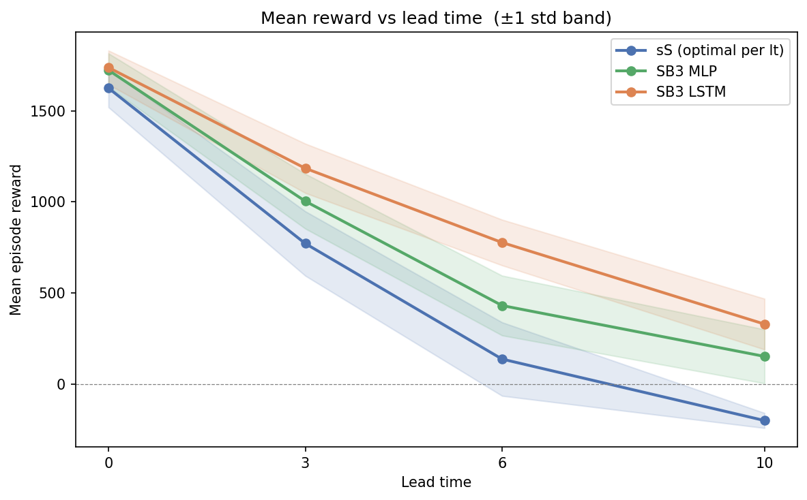

# RL-InventoryControl
This code implements the paper [Reinforcement Learning for Inventory Control under Regime-Switching Demand: A Controlled Comparison of LSTM, MLP, and (s,S) Policies](https://arxiv.org/abs/2611.15945).


## Overview
Classical inventory policies such as (s,S) are provably optimal under stationary demand but cannot adapt when demand 
switches between hidden regimes, and memoryless deep reinforcement learning policies, confined to a fixed observation 
, cannot maintain a belief over latent demand structure. We ask whether a recurrent policy offers a measurable advantage 
over both a memoryless policy and a classical baseline under regime-switching demand, and how that advantage scales with 
supply-chain lead time. We build a custom Gymnasium environment in which daily demand is generated by a two-state 
hidden Markov process with Poisson emissions, so that the regime is known at evaluation time but hidden from the agent. 
An optimised (s,S) heuristic, an MLP PPO agent, and an LSTM Recurrent PPO agent are trained under matched compute and 
evaluated at lead times of 0, 3, 6, and 10 days over 30 deterministic episodes each. The recurrent policy outperforms 
both alternatives at every lead time, and its margin over the MLP widens monotonically with lead time, from parity at 
lead time 0 to 2.17x at lead time 10. Principal component analysis of the LSTM hidden state explains the widening 
gap: the representation shifts from encoding a binary regime indicator at short lead times to encoding multi-step 
pipeline state at long lead times. Recurrent memory becomes the decisive architectural factor as the credit-assignment 
horizon lengthens.


Mean evaluation reward versus lead time for the LSTM, MLP, and (s,S) policies, with one-standard-deviation (std) bands 
over 30 episodes, is shown in the following figure.

<!---  --->


## Installation
Git clone this repo and install dependencies to have the same environment configuration as the one we used.

```shell
git clone https://github.com/nathanlem1/RL-InventoryControl.git
cd RL-InventoryControl/
pip install -r requirements.txt
```


## Training and Evaluation
For training and evaluation, run the following code on terminal. Please look into code for more information.

```shell
python train.py 
```


## Citation

If you use this code for your research, please cite our paper.

```
@misc{HainesBaisa2026,
      title={Reinforcement Learning for Inventory Control under Regime-Switching Demand: A Controlled Comparison of LSTM, MLP, and (s,S) Policies}, 
      author={Alex Haines and Nathanael L. Baisa},
      year={2026},
      eprint={2611.15945},
      archivePrefix={arXiv},
      primaryClass={cs.LG},
      url={https://arxiv.org/abs/2611.15945}, 
}
```

## Acknowledgement

This code is written by Alex Haines (1st author) and refactored by Nathanael L. Baisa (2nd author).